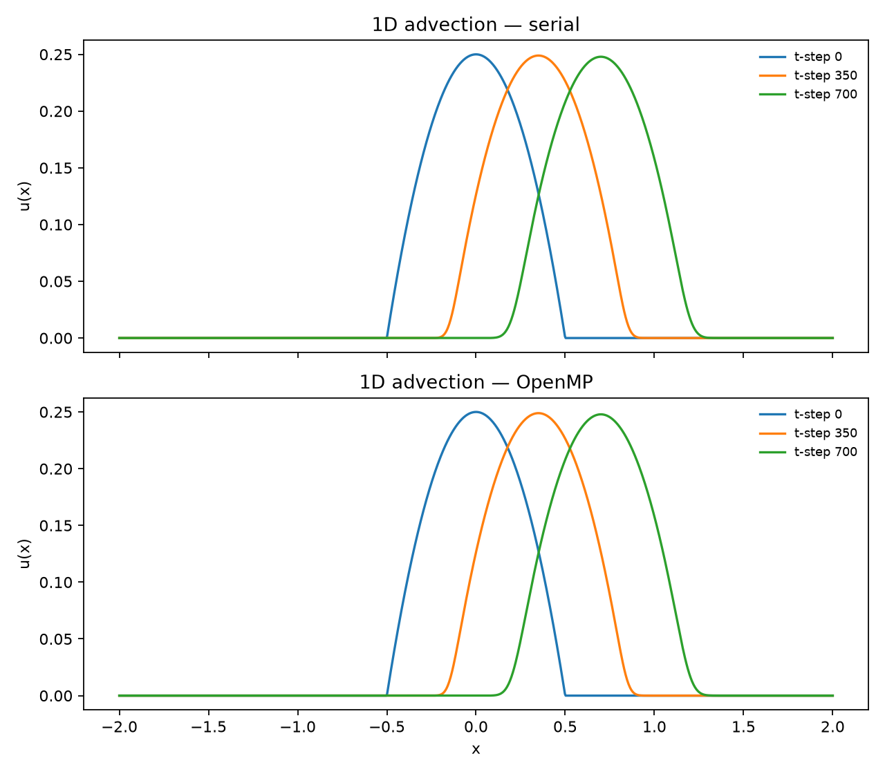
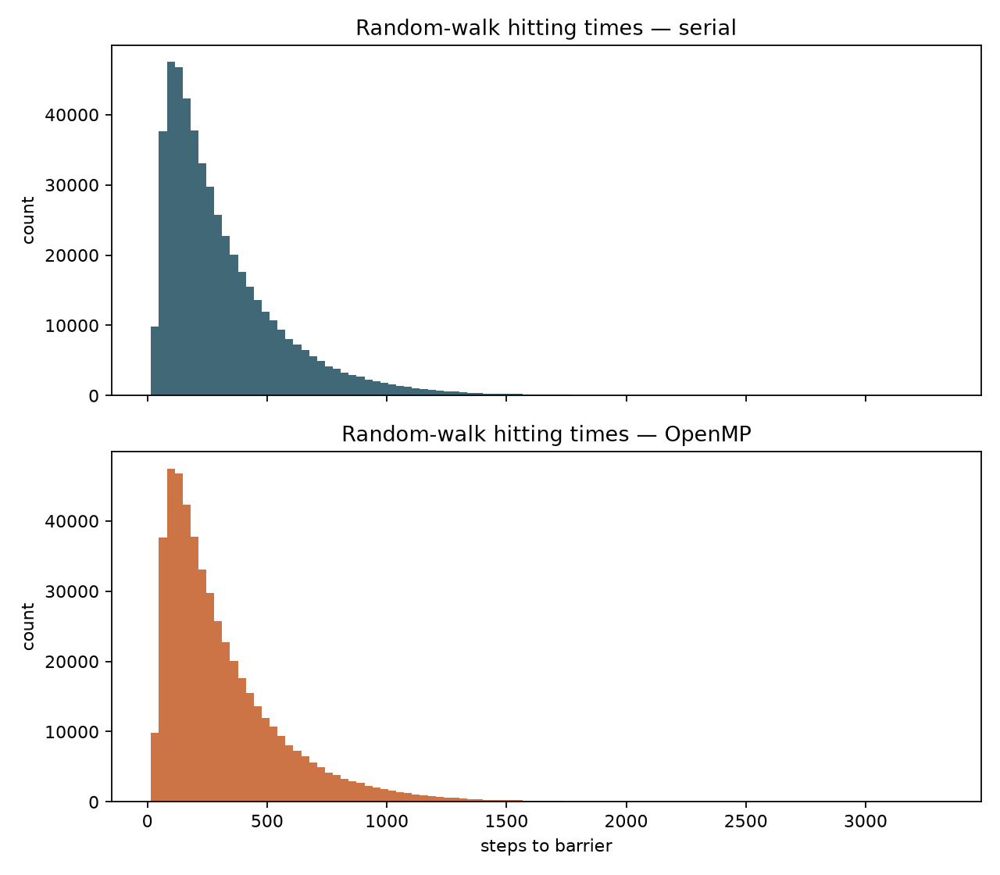
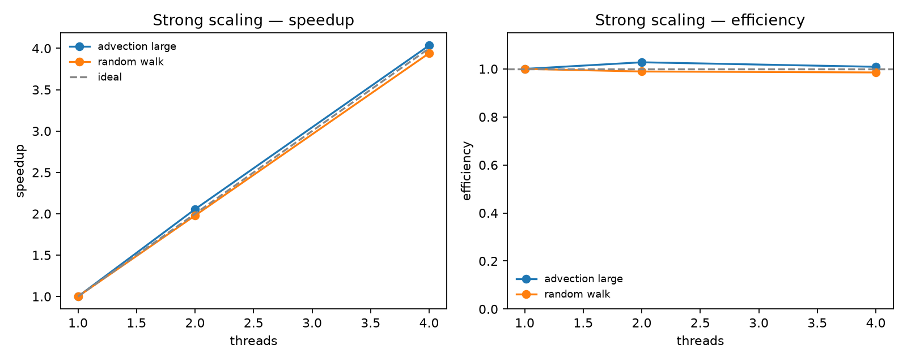

# OpenMP Parallel Numerical Kernels

### Finite-difference advection and Monte Carlo random walks — serial vs shared-memory parallel

This repository is a portfolio case study in **scientific computing with OpenMP**. It starts from a simple question that shows up in real numerical work:

> When you parallelize a solver on a laptop or a single cluster node, where does the speedup actually come from — and when does threading make things *worse*?

To answer that, the project implements two complementary kernels in clean C11:

1. **1D linear advection** — a hyperbolic PDE advanced with a first-order upwind finite-difference scheme. Time levels must stay sequential; OpenMP can only help across space.
2. **Absorbing-barrier random walks** — a Monte Carlo ensemble of independent trajectories. Walkers are embarrassingly parallel, but only if the RNG is thread-safe.

Same physics story as a classic coursework experiment; reshaped as a small, documented software artifact: modular layout, correctness checks, strong-scaling measurements, and figures you can read at a glance.

Full methods and architecture notes: [docs/case-study.md](docs/case-study.md).

---

## Results at a glance

Pulse transport under the upwind scheme. Serial and OpenMP frames match to machine precision:



Hitting-time distribution for $5 \times 10^5$ walkers:



Strong scaling on 1–4 threads. Random walks and a large advection grid scale cleanly; the tiny fidelity grid is kept on purpose to show OpenMP overhead:



Example 4-thread speedups from `results/scaling.example.csv`: random walk ≈ **3.9×**, large advection ($N_x = 2 \times 10^5$) ≈ **4.0×**.

---

## What's inside

| Kernel | Method | Parallel strategy |
| --- | --- | --- |
| Linear advection $\partial_t u + c\,\partial_x u = 0$ | First-order upwind FD | OpenMP over space; time remains sequential |
| Absorbing-barrier random walk | Monte Carlo ensemble | OpenMP over walkers + per-walker `erand48` |

```
include/     Public APIs (advection, random walk, timing)
src/         Solver cores and CLI entry points
scripts/     Benchmark, correctness checks, plotting
docs/        Case-study write-up
results/     Timings and scaling CSVs
figures/     Plots embedded above
.github/     CI smoke workflow
```

---

## Build and run

**Requirements:** GCC with OpenMP, Make, Python 3 (`numpy`, `matplotlib` — see `requirements.txt`).

```bash
make
./scripts/run_benchmark.sh          # fidelity + scaling study + plots
./scripts/run_benchmark.sh --smoke  # short CI-friendly run
```

```bash
./bin/advection --omp
./bin/walk --omp --walkers 500000
MAX_THREADS=8 ./scripts/run_benchmark.sh
```

Useful flags: `--points`, `--steps`, `--dt`, `--walkers`, `--barrier`, `--seed`, `--out`, `--no-snapshots`.

---

## What this demonstrates

- Numerical cores separated from CLI / I/O
- Correct OpenMP placement (no parallelization of dependent time loops)
- Thread-safe Monte Carlo seeding
- Double-buffered PDE integration and I/O-excluded wall timing
- When parallelism helps (large grids / walker ensembles) vs when overhead wins
- Reproducible smoke CI on every push
